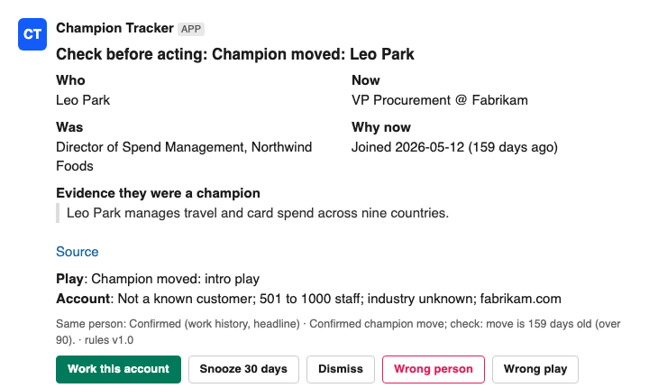

# Champion Tracker

A champion changes jobs. An alert alone isn't enough. This system answers three questions before a seller sees anything:

1. **Is it the same person?** A profile only counts if it is tied to the old company: current employer, work history, or a headline like "ex-Acme". A matching name alone never confirms anything.
2. **Did they actually use and influence the product?** One sentence copied word for word from the evidence decides **Champion** (chose it, rolled it out, owns the program, ran the business case) or **User** (only quoted). A job title alone never makes someone a champion.
3. **Is the new account worth working?** The new company is matched by domain, then checked against existing customers, size and how fresh the move is. Uncertain matches are **held, with the reason shown**.

Each row then gets one decision with a plain-words reason. Clean rows become a Slack card that a seller can act on or correct.



## How it fits the GTM stack

| Layer | Role here | In this repo |
|---|---|---|
| Warehouse (e.g. Snowflake) | Defines who is a champion, from customer and product history | [`sql/champion_definition.sql`](sql/champion_definition.sql) (template) |
| Clay | Tracks job changes, checks the new company, runs the play | [`clay/formulas.md`](clay/formulas.md): the same rule as free Clay formula columns |
| GitHub | Holds the definitions, policies and tests, versioned | [`contracts/`](contracts), [`src/`](src), [`tests/`](tests) |
| Slack | Where the seller reviews, acts and corrects | [`src/champion_tracker/slack_card.py`](src/champion_tracker/slack_card.py), [`feedback.py`](src/champion_tracker/feedback.py) |

The rules sit in code under version control. Slack only delivers the decision; it never makes it.

## The decision checklist ([`contracts/context_contract.yaml`](contracts/context_contract.yaml))

| | |
|---|---|
| **Evidence** | Proof they were a champion (a quoted sentence plus its link) · identity tied to the old company · a real new job · the new account resolved by domain |
| **Authority** | Work history beats headline, and headline beats a name-only match. If the latest job has an end date, the current employer is **unknown**. Domain beats company name. Fields that lag behind a move are never used. |
| **Freshness** | A move is fresh for 90 days, counted from **joining the new company**. A profile older than 365 days can't overrule the evidence. |
| **Confidence** | Confirmed: exactly one tied profile (duplicates of one person merged). Likely: the only same-name profile, with nothing tying it to the old company. Hold: everything else. |
| **Stop rule** | Hold: identity not certain, current employer unknown, a rename, or records that disagree. Review: confirmed, but the move is old, the company is small or unresolved, or the old job is still open. Card: clean. |
| **Feedback** | Accept · snooze · dismiss · wrong person · wrong play. Every action is logged with the rule version. Corrections become new test cases. |

## Run it (no keys needed)

```bash
PYTHONPATH=src python3 -m champion_tracker --seed fixtures/champions.csv --lookups fixtures/candidates.json --today 2026-10-18 --out out
python3 tests/test_rules.py        # 38 tests, standard library only (pytest also works)
```

The fixtures are **synthetic**. Every person and company is invented, but each one copies a failure that showed up in real data. Live mode builds the same candidate lists from a people-data provider ([`adapters/people_data.py`](src/champion_tracker/adapters/people_data.py); keys come from environment variables, never from the repo).

## What happened on real public data ([`docs/eval.md`](docs/eval.md))

The demo run used 126 published customer case studies from one B2B software company:

| Step | Result |
|---|---|
| Named people found by reading the case studies | 195 (181 at customers; 14 excluded: vendor staff, partners, a chatbot) |
| Extraction check against a hand-read answer key (15 stories) | **27/27 people found**; Champion/User agreed on 26/27 |
| Evidence sentences that match the source word for word | **195/195** |
| Decisions (this repo's rules) | Review 19 · Hold 55 · Watch 71 · No action 36 · Excluded 14 · Card 0 |
| Hand-check of every row that would reach a person | 19/19 right person and a real move |
| Same rule as Clay formulas, checked inside Clay | **195/195 match** · **0 credits used** |
| This repo's rules vs the original pipeline, all 195 rows | **1 difference**, a fix: two profiles on one domain (a renamed company) are now merged → Watch instead of Hold |

**Card 0, read honestly:** no *confirmed* champion joined a new company in the last 90 days (freshest: 109 days). 55 people are held because their identity or current employer couldn't be confirmed, so some real moves may be sitting there. Profiles were refreshed a median of 87 days before the run, so a very recent move may not show yet. That detection lag is the number a vendor has to beat. The Card path is covered by tests, not by a real row.

## Failures this system was built to survive ([`docs/failures_fixed.md`](docs/failures_fixed.md))

Same name, different person · a board seat recorded as a new job · a stale profile that contradicts the evidence · an acquired company's email domain · a company matched by name to the wrong firm · a job that already ended treated as current · an acquisition treated as a move · a side gig treated as a move · a search depth that silently held people with common names · a common word in a headline mistaken for the company · a promotion mistaken for a fresh move. All rule failures are tests in [`tests/test_rules.py`](tests/test_rules.py). The search-depth rule lives in the adapter and has a test too. Extraction recall is checked against a hand-read answer key, not a unit test.

## Running it (what is built, what is not)

| Concern | Status |
|---|---|
| Owner for the human queue | Not built. Proposal: Hold and Review rows go to one RevOps owner, cleared weekly. 41 % of customer rows (55 Hold + 19 Review of 181) need a person today. |
| Permissions | Not built. Proposal: only the account owner's click writes to the CRM; other clicks are logged as comments. |
| Write-back | Shape built (`feedback.crm_write_back`), keyed on a row id (CRM contact id), never on a name. Not wired to a CRM client. |
| Monitoring | Not built. Proposal: weekly counts per decision and per hold reason, compared week on week. A sudden jump in "same name" or "lookup failed" means the provider changed. |
| Rollback | The rule version is stamped on every row and every feedback event. Roll back by pinning the previous version of the rules. |
| Learning loop | `feedback.regression_case` turns a "wrong person" or "wrong play" click into a test-case record. Adding it to the test file is still a manual step. |

## Build or buy? ([`docs/build_vs_buy.md`](docs/build_vs_buy.md))

A scorecard for comparing this against a vendor on the **same champion list**: accuracy, missed moves, speed, upkeep and cost. It gives this build's measured numbers and states what still has to be measured.
