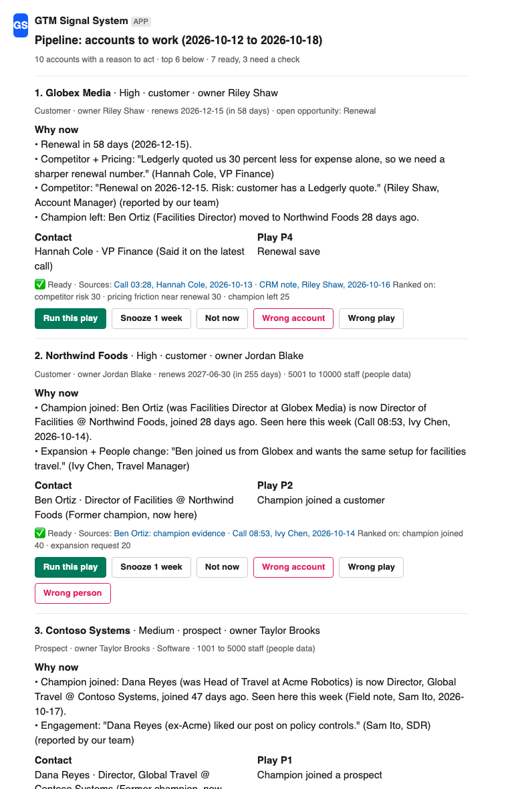

# GTM Signal System

Three parts, built as one system on Snowflake, Clay, GitHub and Slack (package `gtm-signal-system` 2.0.0):

1. **Champion tracker.** A champion changed jobs: is it the same person, did they really champion the product, and is the new account worth working? Each answer carries its evidence; unsure rows are held with the reason.
2. **GTM brief.** Pricing friction, competitors, expansion, timing windows, people changes and engagement from Gong calls, CRM notes and Slack field notes, this period against the last, each quote linked to its source.
3. **Pipeline surface in Slack.** One ranked card per account: why now, who to contact, which play, and the account in one line. A click updates Salesforce and the next run; a correction is saved as a test case.

Every decision is made in code from versioned contracts. Slack shows the result and collects clicks and corrections.



## What it is and what it is not yet

| Status | What |
|---|---|
| Checked on real public data | Champion tracker only: 126 published case studies of one B2B software company, 195 named people, including a full same-name pull for the 37 searches that came back cut off (24 resolved; [results below](#what-happened-on-real-public-data)). Checked by Claude, not yet by a person |
| Runs on demo data | The whole pipeline end to end: invented accounts stored in each API's response shape, 14 people from the demo warehouse, 10 cards, 21 dry-run Slack requests |
| Measured on synthetic text only | GTM brief: two LLM-written evaluation sets ([below](#evaluation-synthetic-text-only)). No real call text was available. The observer's real API path has run on these sets, on `openai/gpt-5.6-luna` |
| Written against the official API docs | Gong, Salesforce, Slack and Snowflake connectors. Tested with fixtures the author generated in each API's response shape; none has run against a live tenant. The real `slack_bolt` / `slack_sdk` and `snowflake-connector-python` libraries accept every call and keyword the code uses |
| Not yet run live | The Slack app's own API calls and buttons in a workspace, CRM write-back, Gong, warehouse history in Snowflake, and the Docker image |

### What was verified live, and how

| What | How | What it does not show |
|---|---|---|
| Champion tracker on public data | 126 case studies, 195 people; GetLeads lookups, then a full same-name pull for the 37 cut-off searches and a second retry of the 13 still held. Result: Card 0 · Review 26 · Hold 32 · Watch 81 · No action 42 · Excluded 14 | Every check was by Claude, not by a person |
| The whole pipeline on demo data | `python3 -m pg_system`: invented accounts in each API's response shape, 10 cards, 21 dry-run Slack requests ([`examples/`](examples)) | Invented data; no tenant |
| GTM brief | Two LLM-written evaluation sets, scored by `tests/test_brief_eval.py` | Synthetic text only; small samples |
| The observer's real API path | `observer.call_openai` through OpenRouter on `openai/gpt-5.6-luna`, 2026-10-18: the held-out half three times, plus the old-set holdout, the tuning half and a 10-row pilot once each; 12 calls, $0.024. The three held-out runs are recorded in `tests/data/` and re-scored by the tests | Not Claude Haiku: the OpenRouter account blocks Anthropic models, so `call_anthropic` has not run |
| Slack output | In the candidate's own Slack, private files only: a canvas from `canvas.md` (accepted as written: headings, tables, links), a List with the 10 next-steps rows, the digest as a self-DM | Sent through a Slack connector, not the app's bot token: the app's own API calls and buttons have not run against Slack |
| The package with real libraries | The wheel `gtm_signal_system-2.0.0-py3-none-any.whl` built in a fresh venv (setuptools 82); `pip install "<wheel>[live]"` works; slack_bolt 1.30.0 / slack_sdk 3.45.0 and snowflake-connector-python 4.5.0 (Python 3.9) and 5.0.0 (Python 3.12) accept every call and keyword the code uses; the Slack app imports and registers its listeners | No Docker on the build machine: the Dockerfile's installs were resolved offline for linux x86_64 and arm64, but no image was built |
| Not run yet | Live Salesforce, Snowflake and Gong (they need trial accounts the candidate must create), a Docker build, the Clay rebuild in the candidate's own workspace, a person's spot-check, the build-vs-buy vendor run, real labelled call text | |

## Run it now (no keys)

```bash
PYTHONPATH=src python3 -m pg_system --out /tmp/gtm-demo
python3 tests/test_rules.py && python3 tests/test_system.py && python3 tests/test_brief.py && python3 tests/test_brief_eval.py && python3 tests/test_surface.py && python3 tests/test_connectors.py && python3 tests/test_regressions.py && python3 tests/test_slack_app.py && python3 tests/test_ops.py
```

The `&&` line stops at the first failing file; `for f in tests/test_*.py; do python3 $f; done` runs all nine and prints every result. The demo and the core use the standard library only (Python 3.9+). Live mode needs `slack_bolt` and `snowflake-connector-python` 3.8.1 or later (`pip install ".[live]"` or `requirements-live.txt`). The wheel builds with setuptools 61 or later (built here with setuptools 82) and installs with `pip install "<wheel>[live]"`; an installed wheel needs `GTM_HOME` set to the folder holding `config.json`, `contracts/` and `sql/`, which the wheel does not contain. The demo data is invented; `scripts/make_fixtures.py` rebuilds it from three readable CSVs, and a test checks the committed files match.

Demo result: decisions Card 2 · Review 1 · Hold 6 · Watch 3 · No action 2, and 10 account cards (7 Ready). The example config raises two run-health alerts: one field note named no account, and 4 card owners have no Slack id. The outputs of this run are in [`examples/`](examples).

| Output (in `--out`, default `out/`) | What it is | Where it goes |
|---|---|---|
| `canvas.md` | The GTM brief, next steps and each card's context line and evidence | A canvas tab in the channel, replaced in place each run |
| `next_steps.csv` | One row per account to work, with its context line | A Slack List shared to the channel, rows updated in place |
| `slack_digest.json` | The top 6 cards with why now, contact, play, tier, context and buttons (the rest go as thread replies, each with its buttons) | The channel; optionally each owner's own accounts by DM (`digest_to`) |
| `ops.md` | Review queue, run health, old moves, metrics and the weekly QA sample | The review owner's canvas; the queue and the QA sample also come as messages with buttons |
| `brief.md`, `brief.json`, `findings.json` | The brief alone, every quote linked to its source; every finding | Docs, other tools |
| `surface.json` | Every card with its inputs, context, ICP fit, evidence links, rank reason and checks | The Slack app, audits |
| `decisions.csv`, `review_queue.csv` | Champion decisions; the Hold and Review rows a person clears | CRM, Clay, RevOps |
| `champion_cards.json` | One Block Kit card per Card or Review row (not posted by the pipeline; account cards carry champion moves) | Previews |
| `clay_surface.csv` | The surface as a flat table, with `In ICP` | Clay ([`clay/surface_formulas.md`](clay/surface_formulas.md)) |
| `skipped_notes.json` | Field notes that named no account | Run health |
| `summary.json`, `history/` | Counts, alerts and metrics, compared with the last run; `history/cards-<run id>.json` feeds the backtest | Monitoring |
| `replay/<run id>/`, `replay/LATEST` | The exact inputs behind every card and queue row; which run's buttons are live | Corrections become replayable test cases |
| `people_cache.jsonl` | People-data lookups and pasted profiles fetched by URL, kept `people_cache_days` (live, API source) | The next run |
| `slack_requests.json` | The exact Slack API calls a live run would make (dry runs only). The demo writes 21: `conversations.info`, `canvases.create`, `slackLists.create`, `slackLists.access.set`, 10 `slackLists.items.create`, `chat.postMessage` (digest), `chat.postMessage` (thread reply with cards 7 to 10), `canvases.create` (review canvas), `conversations.open`, `canvases.access.set` (the review canvas shared through the review owner's DM channel), `chat.postMessage` (review queue), `chat.postMessage` (QA sample) | Review before going live |

## Plug it into your stack

| Step | What to do |
|---|---|
| 1. Install | From a checkout: `pip install ".[live]"` (or `pip install -r requirements-live.txt`), then run it there with `PYTHONPATH=src`. The code reads `config.json`, `contracts/` and `sql/` from the checkout; an installed wheel finds them through `GTM_HOME` (the wheel holds neither them nor `slack_app/`). `snowflake-connector-python` must be 3.8.1 or later: older 3.x silently ignored key-pair sign-in. The wheel was built and installed with the real live libraries ([above](#what-was-verified-live-and-how)). |
| 2. Config | `config.example.json` -> `config.json`: `channel`, `field_notes_channel`, sources on or off (`warehouse`, `people`, `gong`, `salesforce`, `field_notes`), `people_source` (`api` or `clay_csv`), `review_owner`, `owner_slack_ids`, `default_owner`, `pipeline_admins`, `schedule`, `icp`, `blocked`, `preflight_person`. Names, ids and switches only. |
| 3. Keys | `.env.example` lists every variable: Salesforce client credentials, Snowflake key pair, Gong key and API host, people-data URLs and token, Slack tokens, the optional observer, and `GTM_HOME` for an installed wheel. Keys live in the environment or a secret store, never in the repo. |
| 4. Your definitions | Point [`sql/champion_definition.sql`](sql/champion_definition.sql) at your tables; set `SF_RENEWAL_FIELD` and `SF_CUSTOMER_TYPES`; list your competitors and Gong tracker names in [`contracts/lexicon.json`](contracts/lexicon.json) (or start from [`contracts/lexicon.travel-expense.json`](contracts/lexicon.travel-expense.json) with `LEXICON_PATH`); replace the example plays in [`contracts/plays.json`](contracts/plays.json) with your own; fill `icp` if you want the fit check. |
| 5. Salesforce | Create the 7 write-back fields and the permission set in [`salesforce/fields.md`](salesforce/fields.md), and a connected app with the client-credentials flow for an API-only user. Set `SF_INTEGRATION_USER_ID` so that user's own Tasks are never read back as notes. |
| 6. Slack app | Create it from [`slack_app/manifest.yaml`](slack_app/manifest.yaml) and install it: `SLACK_BOT_TOKEN` (bot token) and `SLACK_APP_TOKEN` (app-level token with `connections:write`). Invite the bot to the digest channel and the field-notes channel. |
| 7. Preflight | `PYTHONPATH=src python3 -m pg_system --check`: one small read per switched-on source (Salesforce describe and a `COUNT()`, a Gong call count, Slack auth and channel membership, `EXPLAIN` of the champion SQL so it compiles without being run, and one real people lookup of `preflight_person` when it is set). Writes nothing. |
| 8. Dry run | `PYTHONPATH=src python3 -m pg_system --mode live --out /tmp/gtm-dry`: files only, and `replay/LATEST` is left alone so the buttons already in Slack keep working. Read `canvas.md`, `ops.md`, `summary.json` and `slack_requests.json`. |
| 9. Go live | `PIPELINE_MODE=live PYTHONPATH=src python3 slack_app/app.py`: one process for the buttons, `/pipeline` and the weekly run. CRM write-back stays a dry run until `"write_back": "live"`. Operating it: [`docs/runbook.md`](docs/runbook.md). |

## How it fits the stack

| Layer | Its job | In this repo |
|---|---|---|
| **Snowflake** | Who is a champion, and the history of every run | [`sql/`](sql), [`gtm_connectors/warehouse.py`](src/gtm_connectors/warehouse.py) (`write_run`: decisions, findings, cards and runs by run id; clicks kept for ever, one row per click key) |
| **Clay** | A people-data source through a CSV export; the surface's play rule as free formula columns | [`adapters/clay_export.py`](src/champion_tracker/adapters/clay_export.py), [`clay/`](clay) |
| **Gong, Salesforce, Slack field notes** | What customers said and what reps reported; accounts with owner, renewal, open opportunity, industry, size and country | [`gtm_connectors/`](src/gtm_connectors) |
| **GitHub** | Definitions, plays, lexicons and tests, versioned; the code reads the contracts at runtime | [`contracts/`](contracts), [`tests/`](tests) |
| **Slack** | Delivery and correction: the brief in a canvas, next steps in a List, cards in the channel, the review queue to one owner | [`slack_out.py`](src/pg_surface/slack_out.py), [`slack_post.py`](src/gtm_connectors/slack_post.py), [`slack_app/`](slack_app) |
| **Claude Code** | Run it, explain a card, replay corrections | [`skills/gtm-signal-system/SKILL.md`](skills/gtm-signal-system/SKILL.md) |

Architecture: [`docs/architecture.md`](docs/architecture.md).

## 1. Champion tracker

Champion rules 1.2, from [`contracts/context_contract.yaml`](contracts/context_contract.yaml) and [`contracts/champion_definition.yaml`](contracts/champion_definition.yaml):

| | |
|---|---|
| **Champion** | Warehouse: a won-deal role (decision maker, champion, economic buyer, evaluator) on a deal at the contact's own account closed in the last 3 years, plus product use in the last 365 days; or an admin active in the last 180 days who also holds such a role. An admin seat alone, or a role with no product use, is a user. Test workspaces, internal users and lost deals never count. Public data: a verbatim sentence that shows a decision or ownership, never a title alone. |
| **Evidence** | Proof they were a champion, with its link · a profile tied to the old company (employer, a work-history job that overlaps the evidence date, or a headline such as "ex-Acme") · a real new job (not a board, advisor, trustee, volunteer or self-employed seat) · the new account resolved by domain |
| **Authority** | Work history beats headline; headline beats a name-only match, which never confirms. If the latest job has an end date, the current employer is unknown; a profile that still names the customer while that job has ended is unknown too. Domain beats name; names match after dropping legal suffixes and trailing geography only ("Delta" is not "Delta Dental"), and geography stays when dropping it would leave a generic or short head ("Air Canada" is not "Air India"). A website merely named for the customer counts only when it is the customer's own known domain, or the only domain evidence there is. A person's decision beats every rule. |
| **Freshness** | A move is fresh for 90 days, counted from joining the new company. A start known only to the month is aged from its latest possible day; a move that is fresh only because of that rounding goes to Review. A profile older than 365 days cannot overrule the evidence. Product use up to 60 days after leaving is normal (a last expense report) and does not hold the row. |
| **Duplicates** | Tied profiles that agree on the current employer (domain first) are one person. Two profiles of one LinkedIn member, the same member id under an old and a new URL slug, are one person too, and the freshest copy wins (the old slug's copy stops being refreshed and can still name the customer). Tied profiles that disagree otherwise: Hold. |
| **Confidence** | Confirmed: exactly one tied profile (duplicates merged) or confirmed by the review owner. Likely: the only same-name profile, with nothing tying it. Hold: everything else. |
| **Stop rule** | Hold: identity not certain, a cut-off search or a full same-name pull with nobody tied, current employer unknown, a rename or acquisition, records that disagree (stale profile, product use more than 60 days after leaving), a start date in the future, evidence or link missing. Review: confirmed, but older than 90 days (or fresh only by month rounding), the new company small, of unknown size or without a domain, the old job still open, or a fractional or interim role. Card: clean. |

| Topic | How it works |
|---|---|
| Lookup | Name + company first. Only for misses, every same-name profile 50 deep, with work history. A search that returns the full 50 with nobody tied was cut off: every same-name profile is then pulled with its work history (up to `PEOPLE_DEEP_LIMIT`, default 5,000, through `PEOPLE_EXPORT_URL` when the provider has a bulk endpoint) and tied locally by the rules. People APIs filter on the current employer, which a mover has left, so a company filter cannot find them; `PEOPLE_PAST_COMPANY_FIELD` adds a work-history filter only for providers that have one. Every lookup record says how deep it searched and whether it was cut off (`depth`, `capped`), and a successful one whether every same-name profile was read (`full_search`, `searched`). Nobody tied after a finished pull: "A full search of N same-name profiles found none tied". A pull that did not run or did not finish keeps "Search hit the 50-result cap", never "N people share this name". |
| Rate and retries | One token bucket for every worker (`PEOPLE_RATE_PER_SEC`, default 5 calls a second). Only 408, 429, 5xx and network errors are retried, waiting what `Retry-After` says; other 4xx fail at once. Lookups run in parallel (`people_workers`, default 8) and are cached for `people_cache_days` (default 8, so a weekly run reuses last week's); failed lookups are never cached. |
| Clay as the source | A Clay CSV export ([`clay_export.py`](src/champion_tracker/adapters/clay_export.py)) gives one profile per person, so the namesake check cannot run on that path. |
| Identity overrides | The review owner's This is #n, None of these, Paste the right profile and Can't resolve apply on every later run (`rules.run(overrides=...)`). Profile keys are normalised URLs, so a profile pasted after None of these is confirmed, not still rejected. A pasted profile joins the lookup: fetched by URL when `PEOPLE_PROFILE_URL` is set (cached by URL), else as name + URL, and the row says what is still missing. Can't resolve parks the row: it stays on the review canvas without buttons until a later identity decision. |
| Review candidates | Each queue row lists its same-name profiles most likely first, by a score (customer in the work history 0.4, headline naming the customer 0.2, title words up to 0.2, the customer's country 0.2). The score orders the list; it never decides. |
| New account fields | Move rows carry the new company's size band, industry and country from the profile, for the surface's account context and ICP check. |
| Old moves | Review moves older than `old_move_days` (365) make no seller card; they go to the old-moves table in the review canvas. |
| QA sample | Each run, 5 random rows nobody was sent (Watch, No action, Hold; the same rows for the same run id) go to the review owner with Looks right / Wrong. Wrong opens a form that can name the right decision, and saves a test case. |

## 2. GTM brief

Lexicon 2.4 ([`contracts/lexicon.json`](contracts/lexicon.json)), read at runtime:

| Rule | Example |
|---|---|
| Competitors match whole words; names that are everyday words get `competitor_rules` (case-sensitive, excluded phrases, aliases) | "We spend a lot of time" is not Spendwise; "general ledger" is not Ledgerly |
| Pricing friction needs a price or terms word and a friction cue within 6 words in one sentence, or a standalone phrase, or a comparison that puts our price above another offer | "more than we budgeted" counts; "the FX fees on your card are way higher than Amex" counts; "cut our travel spend" (their own spend) does not, unless it points at us |
| A negated price mention is held, with the reason | "The price was never the issue" |
| Timing needs a named window, or a date next to a purchase word | "contract ends in March" counts; "the expense deadline is the 5th" does not |
| Expansion is a request for more of our product | "We expanded into Mexico last year, no plans for more" is history |
| People change: a named role that left, quit, retired, moved on or is new | "our CFO left last week" counts; someone who "left a comment" does not |
| Our own guesses never count | "I think they'll push on price", "my read is they want a discount" |
| On calls, only the customer's words count, unless our rep repeats them | "to recap, your CFO wants a discount" counts as reported |
| Rep notes count, labelled "reported by our team"; a note repeating a customer's quote is counted once | |
| Renewal dates come from the CRM; a customer raising the renewal counts as timing | |
| Competitor stance: risk (trial, quote, demo, comparing, a parent company or finance pushing it), win (switched away), mention | "finance wants us on TripStack" is a risk |
| What changed: each theme and competitor this period against the last, including competitors that went quiet | |
| Slack mentions inside quotes are turned into plain text, so a quote never pings anyone | |

**A real market's competitor list.** `contracts/lexicon.json` keeps three invented competitor names for the demo. [`contracts/lexicon.travel-expense.json`](contracts/lexicon.travel-expense.json) (version 2.4-travel-expense) is the same lexicon with a real travel-and-expense competitor list: Concur, Expensify, Ramp, Brex, Perk, Amex GBT (Egencia counts as Amex GBT), Spotnana, Emburse, Coupa, Center, Airbase, Pleo, Spendesk and Rippling Spend, with rules for the names that are everyday words ("ramp up" is not Ramp, "I concur" is not Concur, "cost center" is not Center, "Amex" alone is the card issuer). Select it with `LEXICON_PATH=contracts/lexicon.travel-expense.json`; a test fails if the two files drift apart on anything but the competitors. It has no precision or recall figure: the evaluation sets were written with the demo names, and on all 360 evaluation rows it fires only on the two that write a real name (both Concur).

### Evaluation (synthetic text only)

No real call text was available, so every number below comes from text written by LLM agents. Precision / recall. Scored by [`tests/test_brief_eval.py`](tests/test_brief_eval.py); more in [`docs/eval.md`](docs/eval.md).

**(1) Old set.** 160 texts written and labelled by one LLM agent from a spec the rule author wrote. The spec listed phrases and traps the rules already handled, so the set was written knowing the rules. Holdout E081-E160, lexicon only:

| Theme | Lexicon only |
|---|---|
| Pricing friction | 1.00 / 0.67 |
| Competitor | 0.94 / 1.00 |
| Expansion | 1.00 / 0.80 |
| Timing | 1.00 / 0.92 |
| People change | 1.00 / 0.70 (not clean: E088 was seen during a grep) |
| Engagement | 1.00 / 0.60 |

**(2) Independent set.** 200 texts (140 call turns, 35 CRM notes, 25 field notes) written by one agent and labelled by a different agent; neither was shown the rules. First measurement, untuned, on all 200 (a record; it cannot be re-run with today's rules):

| Theme | Lexicon 2.2 | Lexicon + observer (prompt 1.0, three runs) |
|---|---|---|
| Pricing friction | 0.75 / 0.33 | 0.65-0.88 / 0.67-0.78 |
| Competitor | 1.00 / 1.00 | 1.00 / 1.00 |
| Expansion | 0.75 / 0.60 | 0.50-0.54 / 0.70 |
| Timing | 0.56 / 0.50 | 0.38-0.40 / 1.00 |
| People change | 1.00 / 0.45 | 1.00 / 0.91 |
| Engagement | 1.00 / 0.22 | 0.80 / 0.89 |

Then the rules were tuned on N001-N100 only. The tuning-half numbers (0.78-1.00; lexicon alone 0.88-1.00) are high by construction: they are tuning, not a result. The held-out half, N101-N200, was measured **once**:

| Theme (positives in N101-N200) | Lexicon 2.4 only | + observer prompt 1.1, Claude Haiku agents (three runs) | + observer prompt 1.1, real API path on Luna (three runs) |
|---|---|---|---|
| Pricing friction (11) | 0.67 / 0.18 | 0.73-0.89 / 0.73 | 0.89-0.90 / 0.73-0.82 |
| Competitor (9) | 1.00 / 1.00 | 1.00 / 1.00 | 1.00 / 1.00 |
| Expansion (5) | 0.60 / 0.60 | 0.50-0.57 / 0.80 | 0.57-0.67 / 0.80 |
| Timing (3) | 0.67 / 0.67 | 0.33 / 0.67 | 0.29 / 0.67 |
| People change (4) | 1.00 / 0.75 | 1.00 / 1.00 | 1.00 / 1.00 |
| Engagement (4) | 1.00 / 0.75 | 1.00 / 1.00 | 1.00 / 1.00 |

**Plain reading.**
- The lexicon alone misses most pricing pushback on unseen text (recall 0.18 on the held-out half).
- The observer lifts pricing, people-change and engagement recall, but over-fires on timing and expansion (precision 0.33 and 0.50-0.57 with the Haiku agents; 0.29 and 0.57-0.67 through the real API, which made one more timing false hit: "get three quotes, a procurement thing").
- Competitor 1.00 means exact matching of a configured list of three invented names. It says nothing about real competitor names; the real-market list has no figure.
- The samples are small: 3 to 11 positives per theme on the held-out half.
- The Haiku column comes from Claude Haiku agents given the exact prompt text. The Luna column is the code's own path (`observer.call_openai` through OpenRouter, 2026-10-18, 12 calls in all, $0.024): the OpenRouter account's provider settings block Anthropic models, so it ran on `openai/gpt-5.6-luna`. Its held-out replies are recorded in `tests/data/indep_test_observer_real_api_luna_run{1,2,3}.json` and re-scored by `tests/test_brief_eval.py`. Run once on the old-set holdout, it scored the same as or better than the Haiku agents' run on that set, except engagement (recall 0.70: three misses, E089, E104 and E145, against one for the Haiku agents' run, which used prompt 1.0).
- Claude Haiku through the real path still needs Anthropic models allowed in the OpenRouter account, or an `ANTHROPIC_API_KEY`.
- The first live weeks need about 200 real call turns labelled by people before the brief's recall can be trusted.

### Observer and Gong trackers: how the code checks them

| Source | What it adds | What the code checks |
|---|---|---|
| Gong trackers | A tracker hit on a counted turn adds the theme mapped in `contracts/lexicon.json -> gong_trackers` | The confidence rules still apply; a competitor tracker is only a hint, the theme still needs a listed name in the words |
| Model observer (optional, off by default, paid) | Proposes themes, each with the exact words that show it | Only turns the code would count are sent. A theme is kept only if the quoted words appear verbatim in the turn, contain a cue word for that theme (`observer_cues`), do not match its refusal pattern (`observer_not`), name a listed competitor (for competitor), and the turn is not a "price is fine" or own-travel-spend turn (for pricing). Who said it, and whether it counts, stays in code. A finding that exists only because of the observer is stamped with the prompt version (`observer_prompt`). If the observer fails, the run goes on with the lexicon and Gong trackers, and run health says so. |

Provider switch: `"observer": {"enabled": true}` in `config.json`, then `OBSERVER_PROVIDER=anthropic` (`ANTHROPIC_API_KEY`; `OBSERVER_MODEL` optional) or `openai` (any OpenAI-compatible chat completions API at `OPENAI_BASE_URL`; `OPENAI_API_KEY` and `OBSERVER_MODEL`). `OBSERVER_MAX_TURNS` caps the turns sent per run (default 2,000). The OpenAI-compatible call sends `max_tokens` 8000, `temperature` from `OBSERVER_TEMPERATURE` (default 0; empty sends none, and a model that rejects it is asked once more without it) and, when set, `OBSERVER_REASONING_EFFORT` (for example `low`). A batch that fails is counted (`failed_batches`) and the run goes on with the rest.

## 3. Pipeline surface

Plays 1.2 ([`contracts/plays.json`](contracts/plays.json), read at runtime) and surface 1.3. The first matching rule wins; no match means no card. The Clay play formula is generated from the same rules ([`scripts/clay_formula.py`](scripts/clay_formula.py)).

| Play | When |
|---|---|
| P4 Renewal save | Customer, renewal within 120 days, and pricing friction or a competitor risk this period |
| P5 Competitor at a customer | Customer with a competitor trial, quote, demo or evaluation this period |
| P2 Champion joined a customer | A confirmed champion (Card or Review) joined a customer, or a subsidiary of one |
| P12 Expansion already in the pipeline: help close it | Customer asked for more and already has an open opportunity |
| P6 Expansion request | Customer asked for more seats, regions or modules |
| P9 Champion left a customer | A confirmed champion left a customer within 90 days, old job closed |
| P11 Champion inside an open deal: brief the deal owner | A confirmed champion joined a prospect that has an open opportunity |
| P1 Champion joined a prospect | A confirmed champion joined a non-customer |
| P7 Competitor in a deal | Prospect with a competitor risk |
| P8 Pricing concern (prospect) | Prospect with pricing friction |
| P10 Timing window | A contract end, renewal, RFP or proposal window from the customer, and nothing above applies |

P3 (champion still at a customer) is the tracker's play for Watch rows; the surface never falls back to it. The plays are the candidate's examples, to be replaced by the team's own; nobody at the target company has approved them.

Each card leads with the signal that triggered its play and shows each quote once (the customer's words first, then our team's reports). It names who to contact (the moved champion, the champion still there, or whoever said it on the latest call), the play and what to do this week, the sources, a tier (High / Medium / Low) with what it was ranked on, and a status: **Ready**, or **Check first** with the exact check (an old move, an account not in the CRM yet, a CRM id this run did not read, a sister domain of a customer, only our team's report, no one to contact, no account owner, outside the ICP). Champions who joined a listed competitor or partner (`blocked`) get no card, and run health says so.

| Card part | How it works |
|---|---|
| Account context | One line on every card: type, owner, renewal date and days to it, open opportunity, and industry, size and country when known (from Salesforce `Industry`, `NumberOfEmployees` and `BillingCountry`, else the moved champion's profile, marked "people data") |
| ICP fit (optional) | `config.json -> icp`: industries to include or exclude, minimum and maximum employees, countries. A card outside it stays on the list at half the priority (so it ranks lower), with a check saying why; a field that is unknown never fails the check. Empty `icp` = no check |
| Joins | Every source names the account by its Salesforce Account Id (15- and 18-character forms compared), then domain, then name. A CRM id that matches no account read this run is never joined by domain or name |
| Links | A link is written only when its URL cannot break out of Slack's link form; quotes and names are turned into plain text |

On the demo data:

| # | Account | Tier | Play | Status |
|---|---|---|---|---|
| 1 | Globex Media | High | P4 Renewal save | Ready |
| 2 | Northwind Foods | High | P2 Champion joined a customer | Ready |
| 3 | Contoso Systems | Medium | P1 Champion joined a prospect | Ready |
| 4 | Initech | Medium | P5 Competitor at a customer | Ready |
| 5 | Fabrikam | Medium | P11 Champion inside an open deal | Check first |
| 6 | Woodgrove Bank | Medium | P12 Expansion already in the pipeline | Ready |
| 7 | Acme Robotics | Low | P9 Champion left a customer | Check first |
| 8 | Tailspin Toys | Low | P7 Competitor in a deal | Ready |
| 9 | Umbrella Health | Low | P6 Expansion request | Ready |
| 10 | Litware | Low | P8 Pricing concern (prospect) | Check first |

**Who can act.** Account-card actions count only from the card owner's Slack id, decided by the Salesforce owner id (the owner's name counts only when no other owner has it). Routed cards (no account owner) go to `default_owner`, or to the review owner when none is set. Identity actions (This is them, None of these, Paste the right profile, Can't resolve, Wrong person, and the QA labels) count only from the review owner. Anyone else gets a private note, the click is logged as a comment, and the buttons stay. Review-queue and QA buttons stay valid across runs while the row is in the latest run.

| After a click | What happens |
|---|---|
| Run this play | Account fields updated by record id and a Task created on the account (due in 7 days, with why now and the sources). The Task's subject starts with "[GTM Signal]", so it is never read back as a rep's note. The List row moves to Working; next week's card says "Working since" |
| Snooze 1 week | Hidden through the next weekly run (click day + 7 + 1), back on the run after |
| Not now | Hidden through the next two weekly runs (click day + 14 + 1) |
| Wrong account | A short form asks what is wrong; the card stays out until new evidence arrives; saved as a test case |
| Wrong play | A short form, optionally naming the right play (or no card); the answer and the card's exact inputs are saved as a test case |
| Wrong person | Shown when the contact is a matched champion. Anyone's click is saved as a test case; only the review owner's changes identity |
| Test cases | `feedback/regression_cases.jsonl` (git-ignored: real names) or `--regression-file`; replayed by `--check-regressions` (exit 1 when a case marked fixed fails again) and `tests/test_regressions.py`. A case that names the right play or decision passes only when the rules give exactly that answer |
| An older digest | A click on a seller card from an older run is refused. A live dry run leaves `replay/LATEST` alone |

CRM writes stay a dry run (`feedback/crm_write_back.jsonl`) until `"write_back": "live"`. What each action writes: [`salesforce/fields.md`](salesforce/fields.md).

## What happened on real public data

The champion tracker only ([`docs/eval.md`](docs/eval.md)). The real rows are not in this repo (they name real people).

| Step | Result |
|---|---|
| Input | 126 published case studies of one B2B software company |
| Named people | 195: 181 at customers, 14 excluded (vendor staff, partners, a chatbot) |
| Extraction | 6 Claude agents. 27/27 people found against an answer key that Claude made by reading 15 stories (not a human key); Champion / User agreed on 26/27 |
| Evidence sentences found word for word in the source | 195/195 |
| Tagging caveat | The seed's tags were made under the old contract wording: about 19 of the 38 `owns_program` rows would need re-tagging under contract v2 |

Decisions (rules 1.2, with the pipeline's aliases and its customer logo wall as known customers):

| Lookups | Card | Review | Hold | Watch | No action | Excluded |
|---|---:|---:|---:|---:|---:|---:|
| The stored lookups | 0 | 19 | 56 | 70 | 36 | 14 |
| After the full same-name pull for the 37 cut-off searches | 0 | 26 | 32 | 81 | 42 | 14 |

One row moved from Watch to Hold since the previous write-up: a profile that still names the customer although that job ended in 2024 now holds. With the stored lookups, 37 of the 56 holds were cut-off searches and 19 had other reasons. After the pull, the hold rate is 32/181 (18 %), each hold with its reason.

**Card 0, read honestly.** No confirmed champion moved within 90 days. The freshest move has a start date known only to the month, so it is 79 to 109 days old and stays Review with the check "start date known only to the month". Review moves older than `old_move_days` (365) do not become seller cards; they go to the review owner's old-moves table.

**Who checked it.** The 19 Review rows (19/19 the right person with a real move) and the 24 rows the pull resolved were checked by Claude in the session, not by a person. No human spot-check has happened yet.

**Clay.** A 195-row table (CSV import + 5 free formula columns, 0 credits) in a Clay workspace owned by another company, so it cannot be shared and its name is never shown. It holds a pre-review snapshot, and its formula check proves routing only, not identity: the formulas re-compute the final routing from columns the Python had already decided ([`clay/formulas.md`](clay/formulas.md)). In the live system Clay is only a people-data source through a CSV export (one profile per person, so no namesake check).

## The hardest failure: a search cut-off that held real people

| | |
|---|---|
| What happened | The first lookup pulled the 10 closest same-name profiles. For common names the right person was often number 11 or later, so the system said "4 people share this name; none is tied to the customer" and held them. Nothing errored and every reason read as correct. It showed up when people already confirmed in an earlier check dropped to Hold after a lookup change. The fix then was a 50-deep search for misses. |
| Still cut off | On 2026-10-18 the red-team round (review agents in the same session) found the 50-deep search still coming back full, with nobody tied to the customer, for 37 people (34 of them had been labelled "N people share this name"). The list was cut off, so that reason was a false statement of fact. |
| Why a company filter is not the fix | GetLeads cannot filter on past employers: a company filter means the current employer, which a mover has left. So the fix is a full same-name pull with work history, tied locally by the rules. |
| Fixed on the real rows | Run with GetLeads ($0 cash on the unlimited plan; 87,474 fair-use credits), plus one rule the pull brought out (two profiles of one LinkedIn member, the same member id under an old and a new URL slug, are one person; the freshest copy wins): 24 of the 37 resolved (7 Review, 11 Watch, 6 No action), each checked by Claude against the role in the case study. 13 are still Hold: 11 "a full search of N same-name profiles found none tied" (N from 110 to 60,892), 1 with two tied profiles that disagree (two different people, one at the customer and one who left; the story has no date to tell them apart), and 1 profile that still names the customer though that job ended. |
| Second retry of the 13 | A web search for each person's profile, then a GetLeads lookup by profile URL (8 fair-use credits): nothing GetLeads holds, so they stay held. Two leads are written down for a person to check (one appears still at the customer in a recent press release; one may have moved), and one row has initials only. The scripts (`capped_retry.py`, `held_retry.py`) stay outside the repo with the real rows; `capped_retry.py --offline` reproduces the pull from the saved exports. |
| In the live adapter | The same full pull: `PEOPLE_DEEP_LIMIT`, optional `PEOPLE_EXPORT_URL`, and `PEOPLE_PAST_COMPANY_FIELD` only for providers that filter on work history. Run health counts capped searches; the review owner can paste the right profile. Tested with a stubbed provider in `tests/test_rules.py` (`test_a_capped_search_pulls_every_namesake_and_ties_locally`, `test_after_a_full_search_the_hold_says_nothing_is_further_down`). |

Every failure fixed so far, in three rounds: [`docs/failures_fixed.md`](docs/failures_fixed.md).

## Running it in production

| Concern | How it is handled |
|---|---|
| Owner queue | One review owner gets the review queue (Review first, then Hold; candidates ranked by score with This is #n / None of these; Paste the right profile and Can't resolve on every row), a review canvas (old moves over 365 days, metrics, run health) shared through their DM channel, and a weekly QA sample of 5 rows |
| Permissions | As above: the card owner for account cards (by Salesforce owner id), the review owner for identity and QA |
| Write-back | Salesforce PATCH by record id plus a Task, through client credentials (a 401 fetches a new token and retries once; click threads share the token under a lock, and a 401 drops only the token that failed). Dry run to a file until switched on; live PATCHes are not logged by the app yet |
| History | `write_to_warehouse`: each run's decisions, findings, cards and summary by run id (replaced on a rerun); clicks are kept for ever, one row per click key (card or row, time, user, action, profile), so two clicks in one second both land and a purged note reaches the warehouse; one transaction |
| Monitoring | Run health every run: a silent source, failed or capped lookups, calls with no CRM account, unmatched findings, field notes with no account, blocked moves, an observer that failed, owners with no Slack id, unreadable feedback lines, a jump in a hold reason. The app writes a heartbeat every minute; a failed weekly run DMs the review owner. The app checks its Slack token at start-up (not at import): a bad token writes `heartbeat.json` with `ok: false` and the reason, and the app exits with code 2 |
| Metrics | Clicks by action, acceptance rate, wrong person / play / account rates, snooze rate, queue age, time to detect |
| Backtest | `scripts/backtest.py` joins every past card (`history/cards-<run id>.json`, never pruned) to opportunities created in the next 60 days (`--days`): hit rate per play and tier, against accounts with no card. Renewal opportunities are excluded by default. Set the ranking weights from that |
| Versions | Rules 1.2 on every decision row and champion click; surface 1.3 and plays 1.2 on every card; surface 1.3 on every card click; lexicon 2.4 on every finding and the brief; observer prompt 1.1 on every finding that only the observer found, and in the run summary. Roll back with git revert |
| Retention | `keep_runs` (52) replay folders; notes older than `retention_days` (365) are blanked at the start of every run in the feedback log, the saved corrections and the write-back log |
| Reliability | One run at a time per `out/` folder (`out/.run.lock`; a second run exits with a message). State files are written whole (temp file + rename). A Slack error after the digest is posted never breaks its live buttons; the rest of the steps still run and the error goes to run health. Posts and creates are not retried on 5xx or timeouts (no second digest or Task); reads and 429s are. Clicks and the purge share a lock, so no click is lost. People lookups are parallel, cached 8 days and rate-limited. The preflight runs one real people lookup when `preflight_person` is set and validates the champion SQL with `EXPLAIN` |
| Slack safety | The CLI refuses `--post-slack` in demo mode without `--allow-demo-post`; the Slack app posts only when `PIPELINE_MODE=live`; each run is a child process; `/pipeline` works only in the configured channel for listed `pipeline_admins` (refused when the list is empty); Slack Connect channels are refused unless `allow_shared_channel` |

## What is still open

Each needs the candidate or the target team:

- A licence.
- Making the repo public or inviting the reviewer: it is private, and the last push contains only part 1.
- A run against a live tenant: Salesforce, Snowflake and Gong need trial accounts the candidate must create (Salesforce Developer Edition, Snowflake trial; Gong has no sandbox). In Slack, the app's own bot-token calls and buttons (the output went to the candidate's own Slack once, through a Slack connector).
- A Docker build (Docker is not available on the build machine; the Dockerfile's installs were resolved offline only).
- The observer on Claude Haiku through the real path: Anthropic models allowed in the OpenRouter account, or an `ANTHROPIC_API_KEY`.
- A person's spot-check of the real-data decisions (so far every check was done by Claude), including the 13 rows still held and the two leads the second retry wrote down.
- Rebuilding the Clay piece in the candidate's own workspace.
- The build-vs-buy vendor run on the same champion list ([`docs/build_vs_buy.md`](docs/build_vs_buy.md)).
- Real labelled call text (about 200 turns) to measure the brief.
- Re-tagging the real seed under contract v2.

In code: live CRM PATCHes are not logged by the app; the preflight checks the Account fields, not the Contact fields; the Docker image was not built (the wheel was). The full list: [`docs/failures_fixed.md`](docs/failures_fixed.md#what-stays-open).

## Tests

306 checks in 9 files, all passing. Each file exits non-zero on a failure.

| File | Checks | What |
|---|---:|---|
| `tests/test_rules.py` | 71 | Champion rules: each a failure seen on real data or in review, plus controls (including one LinkedIn member under two URL slugs); the live people adapter (full pull, rate limit, retries) |
| `tests/test_system.py` | 78 | Brief, surface, connectors, delivery, pipeline, clicks, state, metrics, backtest, `GTM_HOME` |
| `tests/test_brief.py` | 39 | Lexicon 2.4 rules, the travel-expense lexicon, the observer's checks, its OpenAI-compatible call (token cap, reasoning effort, retry without temperature) and failed batches |
| `tests/test_brief_eval.py` | 10 | Precision / recall floors on the synthetic sets, including the recorded real-API observer runs; the travel-expense list on all 360 rows |
| `tests/test_surface.py` | 29 | Account matching, plays, routing, account context, ICP fit, links, the review queue |
| `tests/test_connectors.py` | 25 | Gong, Salesforce, Slack and warehouse parsers on fixtures; champion SQL; warehouse click keys |
| `tests/test_regressions.py` | 4 | Saved corrections replayed, including cases that name the right answer |
| `tests/test_slack_app.py` | 26 | The Slack app with a fake `slack_bolt`, the start-up token check, the manifest, the packaging files |
| `tests/test_ops.py` | 24 | Operations: run lock, atomic state, purge lock, owner ids, preflight, write retries, caches, the CLI demo guard |

## Repo map

```
contracts/            champion definition, decision contract, plays.json, lexicon.json and lexicon.travel-expense.json (read at runtime)
sql/                  champion definition: Snowflake + SQLite (demo)
src/champion_tracker/ identity, movement and account rules; people data (API or Clay export); Slack card; feedback
src/gtm_briefs/       lexicon, extraction, the brief, the optional model observer
src/pg_surface/       plays, account cards, Slack digest / List / canvas / review queue
src/gtm_connectors/   Gong, Salesforce, Slack notes, warehouse (read + write), Slack delivery
src/pg_system/        the one-command pipeline, preflight, click memory, monitoring, the click-to-test loop
slack_app/            Socket Mode app + manifest (buttons, forms, identity decisions, /pipeline, schedule)
salesforce/           the write-back fields, what each action writes, and the permission set
clay/                 the champion routing and the play rule as free Clay formula columns
skills/               Claude Code skill to run and explain it
scripts/              fixtures, Clay formula, backtest, previews
fixtures/             invented demo data in each API's response shape
examples/             outputs of one demo run, with previews
tests/                306 checks (see above)
docs/                 architecture, evaluation, failures fixed, build vs buy, runbook
```
